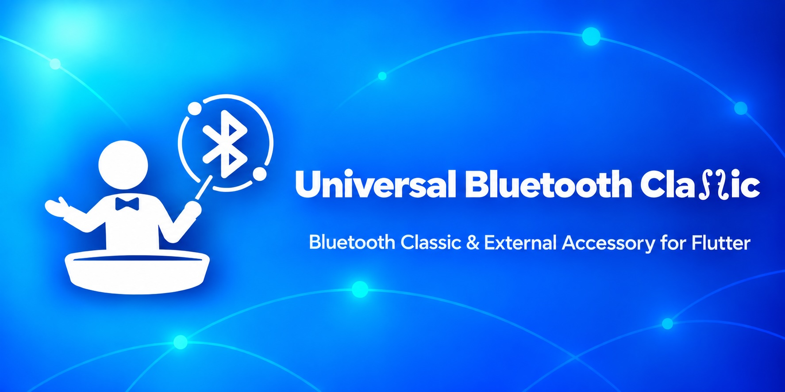

# Universal Bluetooth Classic

<div align="center">
  
</div>

[](https://pub.dev/packages/universal_bluetooth_classic)
[](https://github.com/Navideck/universal_bluetooth)
[](https://github.com/Navideck/universal_bluetooth)
[](https://pub.dev/packages/universal_bluetooth_classic/score)
[](https://flutter.dev)
[](https://dart.dev)

A cross-platform Flutter plugin for discovering, pairing, and managing Bluetooth Classic accessories, Bluetooth HID devices, and Apple External Accessory sessions.

Looking for Bluetooth Low Energy? Check [universal_ble](https://pub.dev/packages/universal_ble).

## Features

- [**Device discovery**](#scanning) — scan for nearby Bluetooth devices and retrieve paired devices.
- [**Pairing**](#pairing) — pair and unpair accessories by address.
- [**Native accessory picker**](#native-accessory-picker) — open the platform picker, with optional device-name filtering. On iOS, this is how you can use MFi-certified Bluetooth Classic devices.
- [**Bluetooth HID**](#connecting) — connect to HID devices and exchange reports.
- [**Serial (SPP/RFCOMM)**](#serial-spprfcomm) — connect to serial accessories on Android, macOS, and Windows.
- [**SDP registration**](#sdp-service-registration) — advertise a Bluetooth HID service.
- [**Apple External Accessory**](#ios-external-accessory) — receive connection events and manage EA sessions on iOS.
- [**Five desktop and mobile platforms**](#api-support) — Android, iOS, macOS, Windows, and Linux.

## API Support

All APIs are called through the same `UniversalBluetooth` class. Platform differences are handled by the plugin; APIs that are not implemented on a platform throw `UnimplementedError`.

**Legend:** ✔️ supported, — not supported, 🚧 work in progress (possible on the platform, not implemented yet).

| API | Android | iOS | macOS | Windows | Linux |
| :-- | :--: | :--: | :--: | :--: | :--: |
| `showBluetoothAccessoryPicker` | ✔️ | ✔️ | ✔️ | ✔️ | — |
| `startScan` / `stopScan` / `isScanning` | ✔️ | — | ✔️ | ✔️ | ✔️ |
| `pair` / `unpair` | ✔️ | — | ✔️ | ✔️ | ✔️ |
| `getPairedDevices` | ✔️ | — | ✔️ | ✔️ | ✔️ |
| `connect` | ✔️ | ✔️ | ✔️ | ✔️ | — |
| `disconnect` | ✔️ | ✔️ | ✔️ | ✔️ | ✔️ |
| `send` | ✔️ | ✔️ | ✔️ | ✔️ | — |
| `setupSdp` / `closeSdp` | ✔️ | — | ✔️ | — | — |
| `onDeviceDiscovered` | ✔️ | — | ✔️ | ✔️ | ✔️ |
| `onDeviceRemoved` | ✔️ | — | ✔️ | ✔️ | — |
| `onConnectionStateChanged` | ✔️ | ✔️ | ✔️ | ✔️ | ✔️ |
| `onData` | ✔️ | ✔️ | ✔️ | ✔️ | — |
| `onGetReport` | ✔️ | — | ✔️ | — | — |
| `onSdpServiceRegistrationUpdate` | ✔️ | — | ✔️ | — | — |

A ✔️ means the API is available. Which transport (if any) carries the bytes is a
separate axis:

| Transport | Android | iOS | macOS | Windows | Linux |
| :-- | :--: | :--: | :--: | :--: | :--: |
| Bluetooth HID | ✔️ | — | ✔️ | 🚧 | 🚧 |
| Serial (SPP/RFCOMM) | ✔️ | — | ✔️ | ✔️ | 🚧 |
| External Accessory | — | ✔️ | — | — | — |

Omit `transport` for the platform default: HID on Android and macOS, serial
(SPP/RFCOMM) on Windows, and an External Accessory session on iOS. On iOS `hid`
and `spp` throw `UnsupportedError`.

Three details the tables cannot show:

- On iOS the identifier is an External Accessory protocol string: `connect`
  opens an `EASession` for it and `disconnect` closes it, closing every open
  session when the identifier is omitted. On every other platform the
  identifier is the device address.
- On Linux only a basic `disconnect` is implemented.
- The 🚧 cells are possible on their platform but not implemented yet: Bluetooth
  HID on Windows and Linux, and serial (SPP/RFCOMM) on Linux.

## Getting Started

Add the package to your `pubspec.yaml`:

```yaml
dependencies:
  universal_bluetooth_classic: ^1.2.0
```

Import it where you need it:

```dart
import 'package:universal_bluetooth_classic/universal_bluetooth_classic.dart';
```

Complete the setup for each target in [Platform-specific setup](#platform-specific-setup) before using the APIs below.

## Scanning

Register discovery callbacks before starting a scan:

```dart
UniversalBluetooth.onDeviceDiscovered = (device) {
  print('${device.name ?? 'Unknown'} (${device.address}), RSSI ${device.rssi}');
};

UniversalBluetooth.onDeviceRemoved = (device) {
  print('Removed: ${device.address}');
};

await UniversalBluetooth.startScan();
```

Check or stop the scan when needed:

```dart
final isScanning = await UniversalBluetooth.isScanning();

if (isScanning) {
  await UniversalBluetooth.stopScan();
}
```

Scanning is available on Android, macOS, Windows, and Linux.

### Paired devices

```dart
final devices = await UniversalBluetooth.getPairedDevices();

for (final device in devices) {
  print('${device.name ?? 'Unknown'} — ${device.address}');
}
```

### Native accessory picker

Open the platform's Bluetooth accessory picker. On iOS, this uses the External Accessory picker — the only way to use Bluetooth Classic MFi devices.

```dart
await UniversalBluetooth.showBluetoothAccessoryPicker();
```

Optionally filter by device name:

```dart
await UniversalBluetooth.showBluetoothAccessoryPicker(
  withNames: ['MyDevice', 'AnotherDevice'],
);
```

The native picker is not available on Linux.

## Pairing

Pair or unpair a device by its Bluetooth address:

```dart
final paired = await UniversalBluetooth.pair(
  '00:11:22:33:44:55',
);

if (paired) {
  print('Device paired');
}

await UniversalBluetooth.unpair('00:11:22:33:44:55');
```

Pairing APIs are available on Android, macOS, Windows, and Linux.

## Connecting

Connect to and disconnect from a device:

```dart
const deviceId = '00:11:22:33:44:55';

UniversalBluetooth.onConnectionStateChanged = (event) {
  print('${event.identifier}: ${event.state.name} (${event.source.name})');
};

await UniversalBluetooth.connect(deviceId);
await UniversalBluetooth.disconnect(deviceId);
```

HID connections are available on Android and macOS. Windows implements the
serial transport only. On iOS, `connect` takes an External Accessory protocol
string and opens an `EASession`, which lets you exchange bytes with the
accessory (see [iOS External Accessory](#ios-external-accessory)). Pass
`transport: BluetoothTransport.spp` to open a serial (SPP/RFCOMM) connection
instead (see [Serial (SPP/RFCOMM)](#serial-spprfcomm)). Linux supports only the
basic `disconnect` operation.

## Sending and receiving data

Send raw bytes to a connected device:

```dart
import 'dart:typed_data';

await UniversalBluetooth.send(
  '00:11:22:33:44:55',
  Uint8List.fromList([0x01, 0x02, 0x03]),
);
```

Receive bytes from a connected device:

```dart
UniversalBluetooth.onData = (identifier, data) {
  print('$identifier: $data');
};
```

On the HID platforms `send` writes an output report and `onData` delivers the
bytes the connected device sends. On iOS both operate on the open External
Accessory session. `sendReport` has been replaced by `send`.

Respond to HID get-report requests:

```dart
UniversalBluetooth.onGetReport =
    (deviceId, reportType, bufferSize) {
  return ReportReply(
    data: Uint8List.fromList([0x01, 0x02, 0x03]),
  );
};
```

HID reports are available on Android and macOS. Windows implements the serial
(SPP/RFCOMM) transport instead; see [Serial (SPP/RFCOMM)](#serial-spprfcomm).

## Serial (SPP/RFCOMM)

Some Bluetooth Classic accessories expose a serial stream over the Serial Port
Profile (SPP) instead of HID. Open one with `transport: BluetoothTransport.spp`:

```dart
import 'dart:typed_data';

import 'package:universal_bluetooth_classic/universal_bluetooth_classic.dart';

const address = '00:11:22:33:44:55';

UniversalBluetooth.onConnectionStateChanged = (event) {
  print('${event.identifier}: ${event.state.name} (${event.source.name})');
};

UniversalBluetooth.onData = (identifier, data) {
  print('$identifier received: $data');
};

// Opens an RFCOMM connection for the well-known SPP service UUID.
await UniversalBluetooth.connect(address, transport: BluetoothTransport.spp);

await UniversalBluetooth.send(address, Uint8List.fromList('PING\r'.codeUnits));

await UniversalBluetooth.disconnect(address);
```

The identifier is the device address, and connection events carry
`source: BluetoothConnectionSource.spp`. Pair the accessory first (for example
with `pair` or the native picker) before connecting.

### Custom service UUID

Most serial accessories use the well-known SPP UUID
(`00001101-0000-1000-8000-00805F9B34FB`, also exported as `sppServiceUuid`),
which is the default and can be omitted. For accessories that advertise a custom
UUID, pass it to `connect`:

```dart
// A vendor-assigned UUID, not the default.
await UniversalBluetooth.connect(
  address,
  transport: BluetoothTransport.spp,
  serviceUuid: '0000AB12-0000-1000-8000-00805F9B34FB',
);
```

The serial transport is available on Android, macOS, and Windows. It is not
available on iOS or Linux. On Windows it is the default transport, so
`transport: BluetoothTransport.spp` may be omitted there; on Android and macOS
it must be requested explicitly.

This transport lets you name the device and the service UUID and get a raw byte
channel. iOS offers no equivalent: Apple exposes neither an RFCOMM socket nor an
SDP query API, and `IOBluetooth` (which the macOS implementation uses) is
macOS-only. That is a limitation of the app-facing API rather than of the
transport on the wire — see [iOS External Accessory](#ios-external-accessory)
for how iOS reaches the same kind of data channel.

To verify against hardware, pair a serial accessory (or another computer
running an RFCOMM server on the SPP UUID), connect with
`transport: BluetoothTransport.spp`, send a known payload, and confirm it
arrives and that replies surface through `onData`. The example app exposes the
same flow.

## SDP Service Registration

Register a Bluetooth HID service with platform-specific configuration:

```dart
import 'dart:typed_data';

final config = SdpConfig(
  macSdpConfig: MacSdpConfig(
    data: {
      'ServiceName': 'My HID Service',
      // Add the remaining SDP properties.
    },
  ),
  androidSdpConfig: AndroidSdpConfig(
    name: 'My HID Service',
    description: 'HID Service Description',
    provider: 'My Company',
    subclass: 0x2540,
    descriptors: Uint8List.fromList([
      // Add the HID report descriptor.
    ]),
  ),
);

UniversalBluetooth.onSdpServiceRegistrationUpdate = (registered) {
  print('SDP service registered: $registered');
};

await UniversalBluetooth.setupSdp(config: config);
```

Close the registration when it is no longer needed:

```dart
await UniversalBluetooth.closeSdp();
```

SDP registration is available on Android, macOS, and Windows.

## iOS External Accessory

External Accessory sessions are iOS-only, but their connection changes use the
same callback as the other platforms.

This is also how iOS reaches the data channel that
[Serial (SPP/RFCOMM)](#serial-spprfcomm) provides on the other platforms.
`BluetoothTransport.spp` is unavailable on iOS, but MFi accessories that expose an
iAP2 data channel implement it over Bluetooth RFCOMM, and an `EASession` hands you
that same byte stream. The difference is who sets it up: Apple's stack selects the
RFCOMM channel from the accessory's advertised protocol string, so you pass a
protocol string rather than a device address plus service UUID, and there is no
SDP lookup to choose. Data pass-through over iAP2 is therefore supported; choosing
an arbitrary RFCOMM endpoint is not.

Pair Bluetooth Classic MFi devices through `showBluetoothAccessoryPicker`,
which presents the system pairing UI for your declared
`UISupportedExternalAccessoryProtocols`.

```dart
UniversalBluetooth.onConnectionStateChanged = (event) {
  final accessory = event.externalAccessory;
  if (accessory == null) return;

  print('${event.state.name}: ${accessory.name}');
  print('Manufacturer: ${accessory.manufacturer}');
  print('Protocols: ${accessory.protocolStrings}');
};
```

Close a session for a specific protocol:

```dart
await UniversalBluetooth.disconnect(
  'com.mycompany.myprotocol',
);
```

Omit the protocol string to close every open session:

```dart
await UniversalBluetooth.disconnect();
```

The `externalAccessory` event payload is only available on iOS.

### Exchanging bytes

Open a session for the accessory's protocol string, then send and receive bytes
over it. For a serial accessory this is the raw byte channel:

```dart
import 'dart:typed_data';

const protocol = 'com.mycompany.myprotocol';

UniversalBluetooth.onData = (identifier, data) {
  print('$identifier received: $data');
};

// Opens an EASession for the protocol. The accessory must be connected and
// must advertise the protocol in its protocolStrings.
await UniversalBluetooth.connect(protocol);

// Send bytes. Frame them however the accessory expects.
await UniversalBluetooth.send(protocol, Uint8List.fromList('PING\r'.codeUnits));
await UniversalBluetooth.send(protocol, Uint8List.fromList([0x01, 0x02, 0x03]));

// Responses arrive through onData.

await UniversalBluetooth.disconnect(protocol);
```

The session uses the protocol string as its identifier, while
`onConnectionStateChanged` reports the accessory-level connection (keyed by
connection ID). A session that fails on its own surfaces as a `disconnected`
event.

## Data Types

### `BluetoothDevice`

Discovered and paired devices expose:

- `address` — the device address on most platforms, the connection ID on iOS
- `name`
- `paired`
- `isConnectedWithHid`
- `rssi`
- `deviceType` — `classic`, `le`, `dual`, or `unknown`
- `deviceClass` — for example `peripheral`, `audioVideo`, or `computer`

### `EAAccessory`

iOS External Accessory events provide the accessory name, manufacturer, model and serial numbers, firmware and hardware revisions, dock type, supported protocol strings, connection status, and connection ID.

### `BluetoothConnectionEvent`

Connection events provide an opaque identifier, a `connected` or `disconnected`
state, and a source: `hid`, `externalAccessory`, `spp`, or `system`. The
External Accessory source also includes the full iOS `EAAccessory` value.

### `DataCallback`

`onData` delivers bytes as `(String identifier, Uint8List data)`. The identifier
is the External Accessory protocol string on iOS and the device ID elsewhere.

### `BluetoothTransport`

`connect` accepts a `transport` argument:

- Omitting it (or passing `null`) picks the platform's natural transport: HID
  on Android and macOS, serial (SPP/RFCOMM) on Windows, and an External
  Accessory session on iOS.
- `BluetoothTransport.hid` connects over Bluetooth HID. It is available on
  Android and macOS; iOS and Linux reject it.
- `BluetoothTransport.spp` opens a serial (SPP/RFCOMM) connection. It is
  available on Android, macOS, and Windows; iOS rejects it, where the External
  Accessory iAP2 byte channel plays that role instead.
- `BluetoothTransport.externalAccessory` opens an External Accessory session.
  It is iOS-only; every other platform rejects it.

For `BluetoothTransport.spp`, `connect` also accepts an optional `serviceUuid`,
defaulting to the well-known `sppServiceUuid`.

### HID configuration

- `SdpConfig` holds the platform-specific `MacSdpConfig` and `AndroidSdpConfig` values used for service registration.
  - `MacSdpConfig` takes an optional `sdpPlistFile` path and a `data` map of SDP properties.
  - `AndroidSdpConfig` requires `name`, `description`, `provider`, `subclass`, and `descriptors`.
- `ReportReply` returns optional report `data` or an optional HID `error` code from `onGetReport`.
- `ReportType` identifies `input`, `output`, and `feature` reports.

## Platform-specific setup

### Android

Add the Bluetooth permissions to `android/app/src/main/AndroidManifest.xml`:

```xml
<uses-permission android:name="android.permission.BLUETOOTH_SCAN" android:usesPermissionFlags="neverForLocation" />
<uses-permission android:name="android.permission.BLUETOOTH_CONNECT" />
<uses-permission android:name="android.permission.BLUETOOTH" android:maxSdkVersion="30" />
<uses-permission android:name="android.permission.BLUETOOTH_ADMIN" android:maxSdkVersion="30" />
<uses-permission android:name="android.permission.ACCESS_FINE_LOCATION" android:maxSdkVersion="30" />
<uses-permission android:name="android.permission.ACCESS_COARSE_LOCATION" android:maxSdkVersion="28" />
```

Set the minimum Android SDK to 23:

```gradle
android {
    defaultConfig {
        minSdkVersion 23
    }
}
```

Request permissions at runtime. For Android 12 and newer, request Bluetooth scan and connect permissions. For Android 11 and older, request location permission. Packages such as [permission_handler](https://pub.dev/packages/permission_handler) can handle these requests.

### iOS

Declare every External Accessory protocol supported by your accessory in `ios/Runner/Info.plist`:

```xml
<key>UISupportedExternalAccessoryProtocols</key>
<array>
    <string>com.yourcompany.yourapp.protocol</string>
</array>
```

### macOS

Add the Bluetooth capability to your macOS target in Xcode.

### Windows

The Bluetooth adapter must support Bluetooth 4.0 or newer. If the system has multiple adapters, the plugin uses the first adapter returned by Windows.

When packaging the app, declare the [`bluetooth` and `radios` capabilities](https://learn.microsoft.com/en-us/windows/uwp/packaging/app-capability-declarations).

### Linux

The Bluetooth adapter must support Bluetooth 4.0 or newer. If the system has multiple adapters, the plugin uses the first adapter returned by BlueZ.

When distributing the app as a snap, add the `bluez` plug to `snapcraft.yaml`:

```yaml
plugs:
  - bluez
```

Linux supports scanning, paired-device lookup, pairing, unpairing, basic disconnects, discovery callbacks, and system connection-state events. The native picker, HID connections and reports, serial (SPP/RFCOMM) connections, and SDP registration are not implemented.

## Customizing Platform Implementation

Provide a custom implementation for testing or an unsupported platform by extending `UniversalBluetoothInterface`:

```dart
class UniversalBluetoothMock
    extends UniversalBluetoothInterface {
  // Override the APIs used by your application.
}

UniversalBluetooth.setInstance(
  UniversalBluetoothMock(),
);
```

Restore the default platform implementation with:

```dart
UniversalBluetooth.setInstance(null);
```

Emit an inbound event by calling the matching field on `callbacks`, for example
`callbacks.onData?.call(identifier, bytes)`. `UniversalBluetooth` assigns its own
registry when it selects the implementation, so the app's `UniversalBluetooth.onXxx`
callbacks receive it.

## Example app

The [`example`](example) project demonstrates discovery, pairing, HID connections, reports, SDP registration, and platform permission handling.

Run it on a connected device or desktop target:

```sh
cd example
flutter run
```

## App showcase

> Built something with Universal Bluetooth? Open a pull request to add it here, including an SVG app icon.
